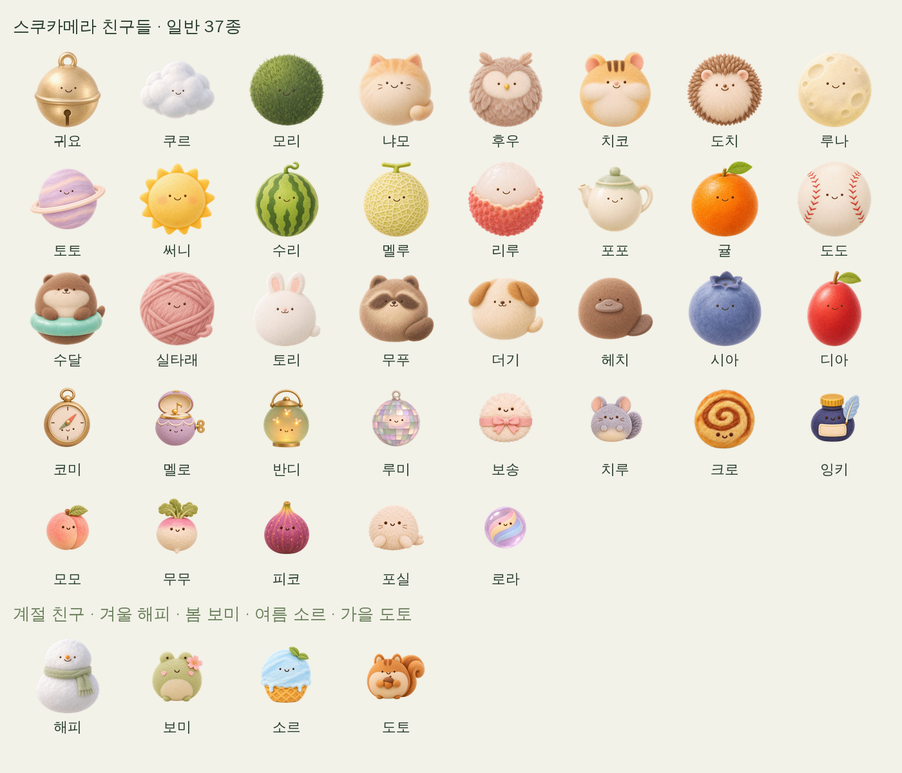
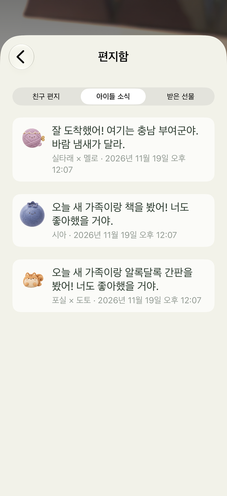

# 스쿠카메라 (SCOO Camera) 🌱📸

**오늘의 한 컷, 초록이 되는 순간.**

사진을 찍을 때마다 화면에 떠 있는 작은 친구가 자라는 **iPhone 빈티지 카메라 앱**이에요. 캐논 IXUS / IXY 시절 실버 디카의 따뜻한 CCD 색감에서 영감을 받았어요. 찍은 사진은 지도 방명록의 핀이 되고, 친구는 교배하고, 유리병에 실어 모르는 사람에게 입양 보내고, 친구끼리 편지를 주고받아요.

<p align="center">
  
</p>

<p align="center">
  
  <br><sub>편지함 → 아이들 소식. 유리병으로 보낸 아이가 새 가족에게서 보내는 편지예요. (이 화면은 기기 안 시험 바다에서 찍은 것이에요.)</sub>
</p>

| 폴더 | 역할 | 실행 |
| --- | --- | --- |
| [`ios/`](ios/) | iPhone 앱 (SwiftUI · AVFoundation, 웹뷰 아님) | Xcode에서 `ios/SCOO.xcodeproj` 열기 |
| [`supabase/`](supabase/) | 서버: 계정·유리병·친구·편지, 교배 그림·대화 함수 | [`supabase/README.md`](supabase/README.md) |
| [`tools/`](tools/) | 캐릭터 그림과 교배 그림 도구 | |
| [`web/`](web/) | 초기 컨셉 홍보용 웹 데모 (지금 앱과 많이 다름) | `cd web && npm run dev` |

## 시작하기

필요한 것: **Mac, Xcode 16 이상, iOS 17 이상 iPhone**. 기기 안 AI 대답은 Xcode 26 · iOS 26 · Apple Intelligence가 되는 iPhone에서만 켜져요.

```sh
git clone https://github.com/jeongmint/scoo-camera.git
cd scoo-camera
open ios/SCOO.xcodeproj
```

1. **SCOO** scheme을 고르고, SCOO·SCOOWidget target의 **Signing & Capabilities**에서 본인 **Team**을 골라요.
2. iPhone을 연결해 **Run (⌘R)**. 실기기 개발자 모드가 필요할 수 있어요.
3. 카메라·위치를 허용하면 지금 있는 시군구의 첫 친구가 찾아와요. 떠 있는 친구를 **짧게 누르면 촬영**이에요.

카메라가 없는 시뮬레이터에서는 앨범에서 사진 불러오기로 해 볼 수 있어요. 시뮬레이터는 기본 위치가 미국이라, 위쪽 메뉴에서 위치를 서울(위도 37.56, 경도 126.97) 등으로 바꿔 주세요.

- **무료 개발자 계정**으로 빌드돼요. Apple 로그인과 원격 푸시는 유료 계정(Apple Developer Program)이 필요해서 꺼 두었어요. 가입한 뒤 `python3 scripts/generate_xcodeproj.py --paid-team`으로 프로젝트를 다시 만들면 켜져요.
- **위젯**은 App Groups `group.com.jeongmint.scoo`를 써요. Bundle ID를 바꿨다면 `ios/SCOO/Resources/SCOO.entitlements`, `ios/SCOOWidget/SCOOWidget.entitlements`, `ios/SCOOShared/WidgetShared.swift`의 `appGroup` 세 곳을 같이 바꿔요.
- 서버 공개 키(publishable)는 생성기에 들어 있어요. **secret / service_role 키와 OpenAI 키는 앱이나 저장소에 넣지 않아요.** OpenAI 키는 Supabase 함수 비밀값(`OPENAI_API_KEY`)에만 있어요.

## 기능

### 카메라
- **떠 있는 친구가 셔터**: 짧게 누르면 촬영, 0.35초 꾹 누른 뒤 끌면 자리 이동. 아래로 쓸면 최대 15초 소리 없는 동영상.
- **Eternal 색감 하나**: 차가운 회색 그림자, 따뜻한 빛, 짙은 검정, 작은 디지털 입자. 미리보기와 저장 사진에 같은 LUT를 써요. 특정 카메라를 측정한 프로파일은 아니에요.
- **촬영 모드**: 자동(기기 안 Vision으로 음식 추정)·일상·음식. 앞·뒤 전환, 탭 초점, 1–3배 줌, 플래시, 날짜 인쇄.
- **같이 찍기**: 촬영 모드 메뉴에서 떠 있는 친구를 고르고, 켜면 사진에도 그 자리 그대로 함께 찍혀요.
- **오늘의 미션**: 하루 하나(하늘·고양이·꽃 등). 사진에 그 대상이 있으면 +15 EXP.

### 친구와 성장
- **첫 친구**: 전국 17개 시도, **229개 시군구**마다 다섯 친구가 살아요(그 동네 친구 + 가까운 동네들의 친구). 처음 켤 때 있는 곳의 다섯 중 한 마리가 와요. 위치를 쓸 수 없으면 아무 동네에서나 와요.
- **친구 41종**: 일반 37종(서울 구에만 사는 친구 9종 포함)과 계절 친구 4종(겨울 해피, 봄 보미, 여름 소르, 가을 도토). 계절 친구는 그 계절에 저절로 찾아오고, 유리병에는 못 타요.
- **성장 (친구마다 따로)**: 일상 +12, 음식 +20, 빛·디테일 보너스 최대 +10 EXP. 경험치는 **그때 카메라에 떠 있던 친구나 아기만** 받아요. 아무도 고르지 않았으면 기본 모리가 받아요. 100 EXP마다 레벨이 오르고 화면에서 조금씩 커져요. 레벨 3에 성장기, 레벨 5에 활짝 만개해요. 찍는 순간 눈을 감고 사진에 맞는 표정(냠냠·감탄·방긋·깜짝)을 지어요.
- **친구 상자**: '작은 친구' → '친구 상자'. 가진 친구마다 레벨, 경험치 막대, 성장 단계, 함께 찍은 사진 수, 어디서 왔는지를 보여 주고, 눌러서 카메라에 띄울 수 있어요. 아래에는 교배로 태어난 아기들이 같은 방식(레벨·경험치·단계)으로 나오고, 아기도 카메라에 띄울 수 있어요. 유리병으로 보낸 친구는 새 집에서 레벨 1부터 다시 자라요.
- **이름 짓기**: 아기는 태어나면 부모 이름을 섞은 이름(멜로 × 루나 → 멜나)을 저절로 받고, 부화 화면에서 바로 지어 주거나 건너뛸 수 있어요. 유리병으로 새로 온 친구·아기, 친구 상자의 상세 화면에서도 언제든 지을 수 있어요. 욕설·성적인 말·혐오 표현, 완성되지 않은 글자(ㅋㅋ), 그림 문자, 전화번호 같은 숫자는 처음부터 못 쓰게 걸러요(모리 이름과 친구에게 보이는 닉네임도 같은 규칙). 지은 이름은 이 iPhone에만 남고, 유리병으로 보내면 원래 이름으로 떠나요.
- **교배**: **만개한 친구**끼리, 부모 A(몸·표정)와 부모 B(색·특징 하나)를 고르면 아기가 태어나요. 그림은 서버의 `breed-image` 함수가 한 조합에 한 번만 그려 모두가 같이 써요(계정당 하루 새 그림 20장). 아기도 친구처럼 떠 있을 때만 자라서 레벨 3에 성장기, 5에 만개해요(예전 아기는 그때까지 자란 만큼을 경험치로 바꿔 둬요). 만개한 아기끼리 다시 교배할 수 있어요(3세대까지).
- **성격 · 애착 사진 · 오늘의 작은 필름**: 사진 습관으로 정해지는 성격, 간직하는 사진 한 장, 오늘 찍은 4장을 이어 붙인 필름.

### 유리병 입양
- 하루 한 번, 가진 친구나 교배 아기 하나를 유리병에 띄워요. 마지막 한 마리는 못 보내요.
- 다음 날, 누군가의 병과 짝이 되면 그 사람의 친구나 아기가 오고, 짝이 없으면 바다에서 새 친구가 와요. **띄운 곳**의 다섯 친구 중 아직 없는 친구가 먼저 와서, 여행 가서 띄우면 그 동네 친구를 데려올 수 있어요.
- 상대가 누군지는 서로 보이지 않아요. 서버 키가 있으면 늘 진짜 사람들과 주고받아요.
- **아이들 소식**: '가끔 소식 전해줘'를 켜고 보낸 아이는 도착 편지를 한 통 보내요. 그 뒤로는 새 가족이 하늘·고양이·꽃 같은 걸 찍었을 때만, 3일 간격으로 최대 6통 와요. **사진은 보내지 않고** 정해진 11개 주제 단어만 오가요. 지역이나 친구 이름을 지어내지 않아요.

### 편지함 · 친구
- 6자리 친구 코드로 친구를 맺고 글·스티커·**사진**을 주고받아요. 사진은 친구끼리만이고, 신고·차단이 있어요.
- **주변 친구 보기**(켰을 때만): 100m 단위로 줄인 위치를 친구에게만 보여 주고, 30분이 지나면 지워져요. **근처에서 친구 추가**는 서버 없이 근처 iPhone끼리 친구 코드를 주고받아요.

### 대화 모드 (티키타카)
- 카메라 위 말풍선을 누르면 떠 있는 친구와 목소리로 이야기해요. 화면 테두리가 친구 색으로 은은하게 빛나요.
- 대답은 **기기 안 AI**(iOS 26) → **서버 AI**(`pet-chat`, 켰을 때만) → **앱 안 간단한 대답** 순서로 써요. 녹음은 남기지 않고, 대화 내용도 저장하지 않아요.

### 지도와 탐험
- **지도 방명록**: 찍은 자리를 사진 핀으로 남겨요. 위치는 이 iPhone에만 저장돼요.
- **동네 탐험 · 도감**: 처음 가 본 시군구에서 찍으면 방문 도장이 찍혀요. 도감에는 가진 친구, 떠난 친구, 시도별 도장, 그 친구가 사는 곳 힌트가 나와요.
- **산책 모드**: 잠금 화면과 다이내믹 아일랜드에 떠 있는 친구, 산책 시간, 찍은 장수, 지금 시군구.
- **위젯**: 레벨, 오늘 찍은 장수, 함께하는 친구, 최근 아기.

### 계정 · 알림
- 로그인 없이 **익명 계정**으로 시작하고, **Google · 카카오**로 이어 두면 앱을 지워도 친구·유리병·편지가 남아요.
- 설정에서 **계정 삭제**를 하면 서버 기록이 바로 지워져요. **개인정보 처리방침**은 앱 안에 있어요.
- 유리병 도착과 아기 편지는 iPhone이 스스로 맞춰 두는 알림이에요.

### 운영자 모드
- 서버가 운영자로 표시한 계정에만 설정에 **운영자 모드**가 보여요. 그 안에 첫 친구 다시 받기, 모든 친구 열기, 1분 배송이 있어요.
- 일반 계정은 하루 1번 띄우고 하루 걸려 도착해요. 1분 배송과 하루 여러 번 띄우기는 서버도 운영자에게만 허락해요.
- 운영자 지정은 SQL Editor에서 `update public.profiles set is_tester = true where id = '<계정 번호>';`로 해요.

## 남은 일

**확인**
- [ ] Mac에서 빌드하고 시험(⌘U) 돌리기. 이 저장소를 고친 환경에는 Xcode가 없어서, 최근 변경(운영자 모드, 편지 규칙, 대화 목소리)은 아직 빌드해 보지 못했어요.
- [ ] 진짜 서버로 두 계정 시험: 시뮬레이터 계정을 운영자로 켜고, 유리병 맞교환과 아이들 소식이 오가는지 보기.

**유료 개발자 계정 뒤**
- [ ] Apple 로그인 켜기(코드는 들어 있음).
- [ ] 새 친구 편지·친구 요청 원격 푸시 켜기(서버는 완료).

**출시 전**
- [ ] 채팅에 붙여 넣었던 OpenAI 키 새로 바꾸기.
- [ ] 익명 가입 남용 막기(캡차·요청 제한).
- [ ] Google 로그인 브랜드 인증, 카카오는 이메일만 받기로 전환.
- [ ] 신고가 들어왔을 때 운영자가 보고 처리할 화면.
- [ ] 대화 모드 서버 AI를 출시용 유료 모델로 받치기.
- [ ] App Store 개인정보 표시, 홍보용 웹 데모를 지금 앱에 맞게 바꾸기.

**정할 것**
- [ ] 도장만 찍히는 탐험을 어떻게 넓힐지.
- [ ] 진짜 편지에 새 가족의 시도(예: "충남")를 넣을지.
- [ ] 임시 기준들: 감탄 판정(빛·디테일 보너스 8 이상), 성장 사진 수(5·10장), 하루 교배 그림 20장.
- [ ] 냐모·쿠르·귀요에게도 서울 구를 줄지.

## 구성

```text
ios/
  SCOO.xcodeproj/        생성기로 만든 프로젝트 (python3 scripts/generate_xcodeproj.py)
  SCOO/
    App/                 시작점, 폰 알림
    Camera/              촬영, 대화 모드(음성 인식·목소리·기기 안 AI)
    Processing/          Eternal LUT, Vision, 사진 저장
    Models/              성장, 친구, 시군구, 유리병, 편지, 교배
    Server/              Supabase 연결, 로그인, 친구·편지, 운영자 모드
    Views/               카메라, 앨범, 지도, 유리병, 편지함, 도감, 설정
  SCOOWidget/            홈·잠금 화면 위젯, 산책 모드
  SCOOTests/             성장, LUT, 시군구, 교배, 유리병, 편지, 알림, 운영자 모드 등
supabase/
  migrations/            표, 보안 규칙, 함수 (순서대로 적용)
  functions/             breed-image, pet-chat, kakao-login, push
  tests/                 로컬 PostgreSQL 시나리오
```

명령행 빌드:

```sh
xcodebuild -project ios/SCOO.xcodeproj -scheme SCOO \
  -sdk iphonesimulator -destination 'generic/platform=iOS Simulator' \
  CODE_SIGNING_ALLOWED=NO build
```

프로젝트 파일은 생성기로 만들어요. Xcode에서 바꾼 프로젝트 설정은 다시 만들기 전에 생성기에도 넣어 주세요.

## 보관과 권한

- 사진과 성장 기록은 이 iPhone의 앱 보관함(`Application Support/SCOO/`)에만 있어요. 사진은 서버로 보내지 않고, 광고·분석 도구는 없어요.
- 서버에는 계정, 유리병, 친구·편지(친구에게 보낸 사진 포함), 아기 편지용 주제 단어, 하루 사용 횟수만 있어요.
- 권한: 카메라, 위치(앱 사용 중), 사진 추가, 마이크·음성 인식(대화 모드), 근처 기기(근처 친구 추가), 알림. 필요한 순간에 물어봐요.
- 앱을 지우면 앱 안의 사진도 사라져요. 중요한 사진은 사진 앱에 저장해 주세요.

---

Little moments, little growth. **SCOO**
